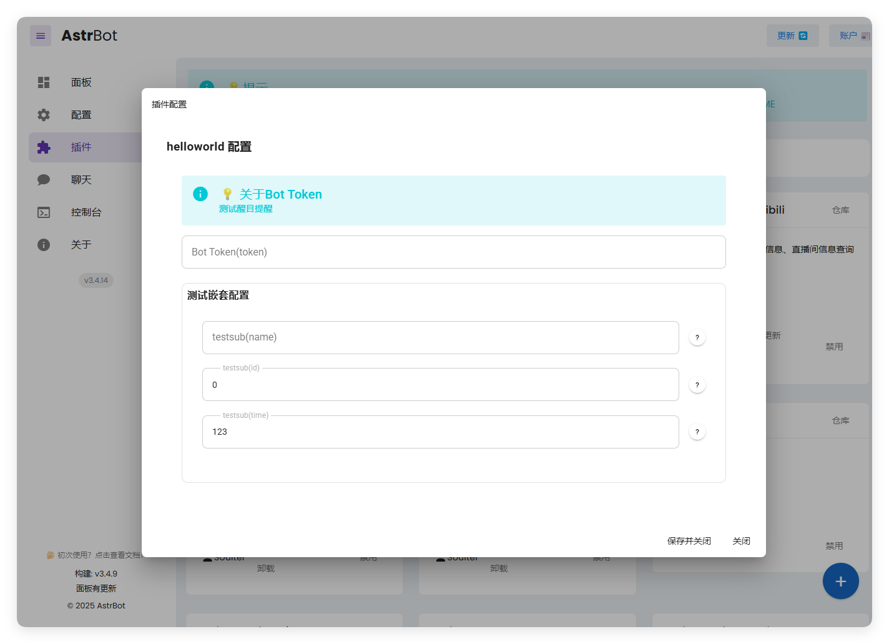

# Happy Horse video for AstrBot

Generate one Happy Horse video in an AstrBot conversation through your own Ace Data Cloud account. `happyhorse_generate_video` submits one text or first-frame image video job; `happyhorse_get_task` queries the same task until its final video is ready.

**This PR targets 0.1.1** with native help/admin lookup commands, bilingual configuration and illustrated setup. Existing 0.1.0 installations do not gain these entries until the source is merged and the package is published/updated.

This independent **Happy Horse integration is provided by Ace Data Cloud**. It is not an official plugin from the Happy Horse publisher or the AstrBot team. Use your own Ace account and API key.

[简体中文指南](readme/README_zh_Hans.md) · [Happy Horse Videos API](https://platform.acedata.cloud/documents/happyhorse-videos?utm_source=opensource&utm_medium=referral&utm_campaign=evergreen&utm_content=happyhorseastrbot_readme_documents_happyhorse_videos) · [Happy Horse Tasks API](https://platform.acedata.cloud/documents/happyhorse-tasks?utm_source=opensource&utm_medium=referral&utm_campaign=evergreen&utm_content=happyhorseastrbot_readme_documents_happyhorse_tasks) · [Current prices](https://platform.acedata.cloud/services/happyhorse?utm_source=opensource&utm_medium=referral&utm_campaign=evergreen&utm_content=happyhorseastrbot_readme_services_happyhorse)

## Find and install

Current upstream navigation (2026-10-18): **Plugins → Plugins → Plugin Market / Installed**. The earlier tested 4.28.2 English UI may label the section Extensions. Configure this service in the installed plugin gear; **do not paste its key into model-provider settings**.

**Publication status (2026-10-18): not yet listed in the official market.** After publication, open [AstrBot Cloud Plugin Market](https://cloud.astrbot.app/market), search **Happy Horse**, and verify **Happy Horse by Ace Data Cloud / acedatacloud**. For the current preview, use the repository URL below; a repository install is not official market publication.

The official AstrBot Cloud listing is pending. The source release is merged; **Plugins → Plugins → Installed → Install Plugin (+) → Install from URL** with `https://github.com/AceDataCloud/HappyHorseAstrBot` can preview it. A URL installation does not prove market publication.

## Configure your key

[Register or sign in to Ace](https://platform.acedata.cloud/console/applications?utm_source=opensource&utm_medium=referral&utm_campaign=evergreen&utm_content=happyhorseastrbot_readme_signup) first. Initialize **General application** if it does not exist. The following images show the shared Ace Applications page, not AstrBot.

In [Ace Data Cloud Applications](https://platform.acedata.cloud/console/applications?utm_source=opensource&utm_medium=referral&utm_campaign=evergreen&utm_content=happyhorseastrbot_readme_api_key), copy a generation API key from your General application or create a key that permits both `/happyhorse/videos` and `/happyhorse/tasks`. Check current per-second pricing, duration, resolution, and balance before submitting. Paste the key into the plugin's **Ace Data Cloud generation API key with Happy Horse access** setting. Do not add `Bearer ` or use a `platform-...` management token. AstrBot masks the field in WebUI but stores the original value in its data directory, which should be protected.

For Agent-tool use, select a chat model that supports tool calling. Allow both Happy Horse tools in the conversation's profile and persona.

1. Open **General application**. Use **1** to copy the existing key, or **2 Manage Keys → Create** for a dedicated key.

2. Use a name such as `AstrBot Happy Horse`. Set expiry/limits as needed and allow both `/happyhorse/videos` and `/happyhorse/tasks`. The screenshot’s Dify tutorial name is an older example.

Images reused and checked on 2026-10-18; original capture dates were not supplied. Credentials and balance are redacted. [Sources and version limits](_assets/tutorial/sources.json).

### Where to paste it in AstrBot

Open **Plugins → Plugins → Installed**, select the gear on **Happy Horse by Ace Data Cloud**, paste the key into **Ace Data Cloud generation API key with Happy Horse access** (stored as `api_key`), and save. No `Bearer ` prefix; never paste the key in chat.

This is the official AstrBot `helloworld` configuration example, labelled v3.4.14 (build v3.4.9), not an Ace setup or run. The instructions above identify this plugin’s exact field and current navigation; later UI layouts may differ.

## Native commands without a chat model

| Input | Result |
| --- | --- |
| `/happyhorse_ace` | Show service, Token setup and lookup help; no external API call. |
| `/happyhorse_ace_task <task_id>` | AstrBot administrators only: retrieve one existing task, with status/final media; no LLM or generation. |

Commands use the default `/` prefix; adapt it if your instance uses another wake prefix. AstrBot enforces administrator identity. The instance shares this plugin key, so direct lookup is administrator-only; other users use Agent tools allowed by their profile/persona. For `pending`, query the same ID later; for `failed`, inspect the original task/trace.

## Generate once, then query

Ask the bot:

> Use `happyhorse_generate_video` exactly once to make a yellow paper kite rising over a calm green meadow. Use `happyhorse-1.1-t2v`, 3 seconds, 720P, 16:9. Show me the task ID.

The tool sends one asynchronous `POST /happyhorse/videos` request and returns `status: submitted` with a task ID. Keep the ID and ask:

> Use `happyhorse_get_task` with the exact task ID `<task_id>`. Tell me its status and final video URL. Do not generate another video.

If pending, query the same ID later. Only `status: succeeded`, `success: true`, and a final HTTPS video URL indicate completion. The plugin never retries a paid submission automatically.

Text video uses `happyhorse-1.0-t2v` or `happyhorse-1.1-t2v`. To animate an image you own or may process, provide its public HTTPS `image_url` and explicitly choose `happyhorse-1.0-i2v` or `happyhorse-1.1-i2v`; the plugin will not switch models automatically. Supported duration is 3–15 seconds; resolution is `720P` or `1080P`. This first version fixes `watermark` to false and supports one first-frame image. Multi-image reference generation and video editing are outside its scope.

## Verify and troubleshoot

Match a returned trace ID in Ace Data Cloud usage when available. A finished task may include public `cost` amounts in Credits; confirm the live usage row before treating an estimate as a charge. Task lookup reads an existing job and does not submit another generation.

| Symptom | Check |
| --- | --- |
| Plugin fails to load | AstrBot version, **Failed to Load Plugins**, and **Data & Logs → Logs**. |
| Tools are missing | Plugin enabled, both tools allowed in the active profile and persona, chat model supports tool calling. |
| HTTP 401/403 | Key type, both allowed API paths, and account access. |
| Network error after submission | Inspect request history before generating again; a timeout may already have created a paid task. |
| Pending task | Query the same task ID later. |
| Failed task | Use the task or trace ID to inspect request history. |

The key goes only to `https://api.acedata.cloud`; redirects are rejected. The plugin exposes final video URLs and public cost fields to the model, without raw internal data. It uses Python's standard library and needs no runtime package installation.

## Validation and brand asset

On official AstrBot `v4.28.2`, an isolated editable installation registered both tools. ChatUI submitted one `happyhorse-1.1-t2v` 3-second 720P video and queried the same task ID once, with no second generation. The final MP4 responded HTTP 200, `video/mp4`, and decoded as H.264 video with AAC audio, 1280×720, 3.163 seconds. The exact generation trace matched one successful `/happyhorse/videos` usage row with 2.97 Credits deducted; the task returned 3.3 Credits as its list amount. See the [sanitized evidence](tests/e2e-results.json). Image-to-video and other models and settings were validated structurally but not generated. This is a local editable installation; official Cloud review, market installation, and a first call from a market installation remain open.

`logo.png` is a PNG encoding of the unmodified 447×447 [current Happy Horse service icon](https://cdn.acedata.cloud/e58fce2811.jpg). Source JPEG SHA-256: `58c5821d63219093ca86d5780231612218c472d66f8a66a59131a873fc736d0f`; packaged PNG SHA-256: `28d49c107808fe2a5779b56338f53df947ad6c2335755aaae5c483540ee3a4d1`.
